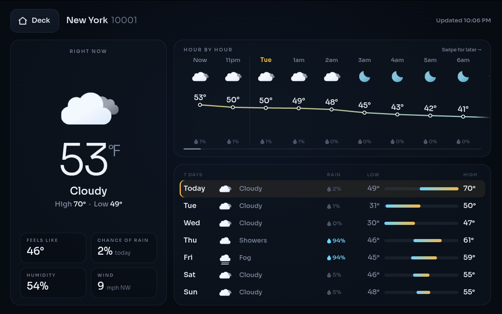
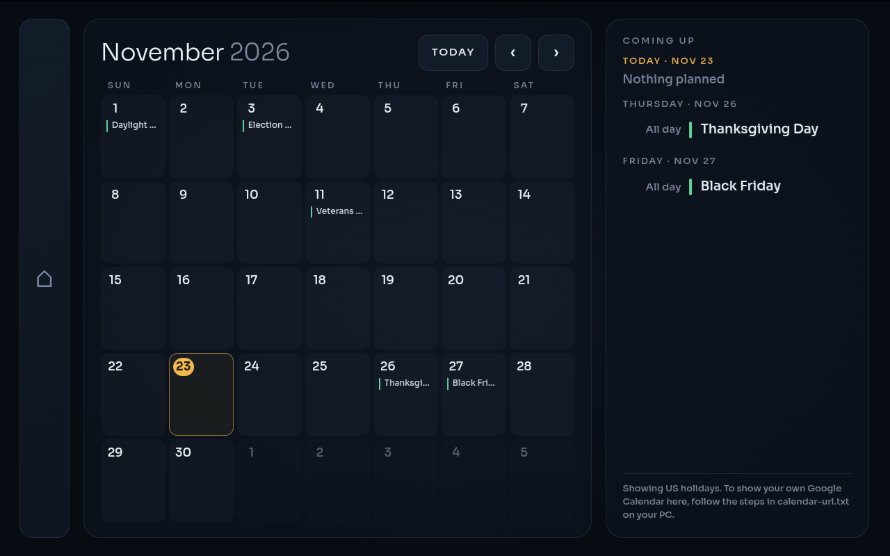

# Home Deck

Turn an Echo Show 8 (or any Android tablet) into a touch control desk for your home and your Windows PC.


- **Top left: apps on the screen itself.** Weather, a timer and alarm, your calendar, and Google. These work even when your PC is off.
- **Top right: apps on your PC.** One tap opens Claude, ChatGPT, Terminal, Obsidian, or anything else you list.
- **Middle: Claude usage.** Your 5-hour and weekly Claude plan usage, and when each one resets. This is optional.
- **Bottom: a clock and PC media keys.** Play/pause, next and previous, and volume.
- **"Alexa, open sesame"** brings the deck back from the Alexa screen (Echo only, optional).

| Weather | Calendar |
|---|---|
|  |  |

## What you need

- **A Windows PC** with [Python 3.10+](https://www.python.org/downloads/). Nothing else needs installing.
- **A screen:**
  - **Any Android tablet** works: just install Fully Kiosk Browser and the deck runs.
  - **An Echo Show 8 (2nd gen)** has to be unlocked and rooted first. This is risky and could brick it. It isn't covered here: see the *saiyaku-athena* thread by R0rt1z2 on XDA Forums, and only do it if you're OK losing the device.
- **[Fully Kiosk Browser](https://www.fully-kiosk.com/)** on the screen. The free version is enough. Download it from its own site.
- **adb** ([Android platform-tools](https://developer.android.com/tools/releases/platform-tools)) on the PC, with the screen connected by USB.
- The screen and the PC on the same Wi-Fi.

## Setup

1. **Download this repo** to your PC.
2. **Copy `settings.example.json` to `settings.json`** and fill it in:
   - `weather`: your town's name, a short label (like a ZIP code), its latitude and longitude, and `"us"` (°F, mph) or `"metric"` (°C, km/h). You can find the coordinates on Google Maps: right-click a spot to copy them.
   - `calendars`: Google Calendar *secret iCal addresses*, if you want them (see below). Up to 4 get their own colour.
   - `claude_usage`: `false` hides the Claude usage panel.
   - `adb`: the full path to `adb.exe`, if it isn't on your PATH.
3. **Choose your PC apps** in `pads.json`.
   - Each PC pad has an `id`, a logo (`icon`, from [Iconify](https://icon-sets.iconify.design/)), and `pc`: what to open.
   - `pc` can be a program's path, a link, or a Store app as `shell:AppsFolder\…`. To find a Store app's name, run `Get-StartApps` in PowerShell.
4. **Start the PC helper:** `python deck_server.py`.
   - When Windows Firewall asks, allow Python on **private** networks.
   - To start it hidden at every login, make a shortcut in `shell:startup` to `pythonw.exe "C:\path\to\deck_server.py"`. Its output then goes to `deck.log`.
5. **Copy the deck to the screen:** plug it in by USB and run `python sync_echo.py`.
   - This copies the pages, makes Fully open the deck on start, and gives Fully permission to read them.
   - Setting Fully's start page needs root. On a normal tablet, set Fully's *Start URL* to `file:///sdcard/Android/data/de.ozerov.fully/files/home-deck/index.html` yourself.

Run `sync_echo.py` again whenever you edit a page, `pads.json` or `settings.json`, or when your PC's IP address changes.

### Your Google Calendar (no sign-in on the screen)

1. Open calendar.google.com, then Settings, then click your calendar under "Settings for my calendars".
2. Copy the **Secret address in iCal format** (it ends in `basic.ics`).
3. Paste it into `"calendars"` in `settings.json`, then run `sync_echo.py`.

Keep that address private: anyone who has it can read the calendar. If it leaks, press **Reset** next to it in Google Calendar.

### Claude usage (optional)

The helper reads the Claude sign-in that Claude Code saves on your PC (`~/.claude/.credentials.json`). Every 5 minutes it asks `api.anthropic.com` for your plan usage. It only saves the numbers, and the sign-in never leaves your PC except to go to Anthropic.

- This uses an **unofficial** endpoint, so it may stop working at any time.
- You need [Claude Code](https://claude.com/claude-code) installed and signed in on the PC.
- To turn it off, set `"claude_usage": false`.

### "Alexa, open sesame" (Echo only, optional)

On a rooted Echo Show, Alexa won't open apps. `echo-app/` is a tiny Android accessibility service that watches only Alexa's own screen. When your newest request reads "open sesame", it closes Alexa and brings Fully back to the front.

```sh
sh echo-app/build.sh            # needs Google's build-tools 36 + android-28 platform, a JDK and Python; see the top of build.sh
adb install -r echo-app/out/open-sesame.apk
adb shell settings put secure enabled_accessibility_services com.homedeck.opensesame/.OpenSesame
adb shell settings put secure accessibility_enabled 1
```

To turn it off, run `adb uninstall com.homedeck.opensesame`.

## How it works

- **The pages run on the screen.** They live in Fully's own folder on the screen and load from `file://`, so they work with the PC off.
  - `sync_echo.py` writes `config.js` (your PC's address, the helper key, and your settings) and `pads.js` next to them.
  - Weather comes from [Open-Meteo](https://open-meteo.com/) (free, no key). The calendar reads iCal feeds directly, with its own repeat-event support.
- **`deck_server.py` is the PC helper.** It's plain Python with no installs, and listens on port 8765.
  - It only opens apps listed in `pads.json` and only presses media keys.
  - Every request has to carry a random key that it creates in `.deck-key` on first run, and it hides that key in its log.
- **Built for a 1280×800 screen.** Pages shrink themselves to fit smaller screens.

## Safety notes

- Never upload or share `settings.json`, `.deck-key` or `deck.log`. They're already in `.gitignore`.
- Anyone on your Wi-Fi who learns the key could open the listed apps or press the media keys, but nothing else.
- The screen talks to the PC over plain HTTP on your home network, so only use it on a Wi-Fi you trust, and allow the helper on **private** networks only.
- The key is also saved on the screen (in `config.js`, in Fully's folder).
- The pages load fonts from Google Fonts and logos from Iconify, so those services see your IP address when a page opens.
- This project isn't made by or connected to Amazon, Anthropic, Google or Fully Kiosk. Logos are loaded from Iconify, and they belong to their owners.

## License

MIT. See [LICENSE](LICENSE).
