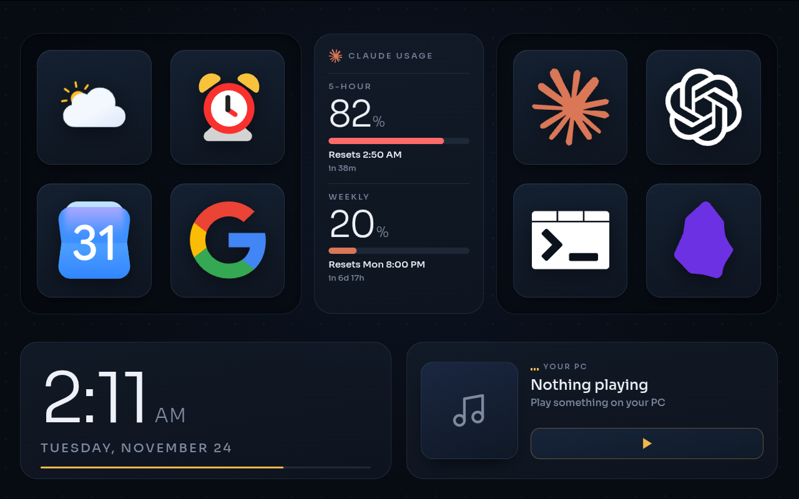
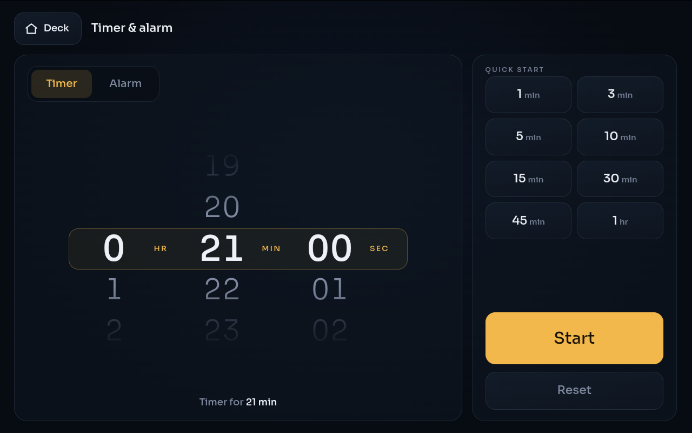
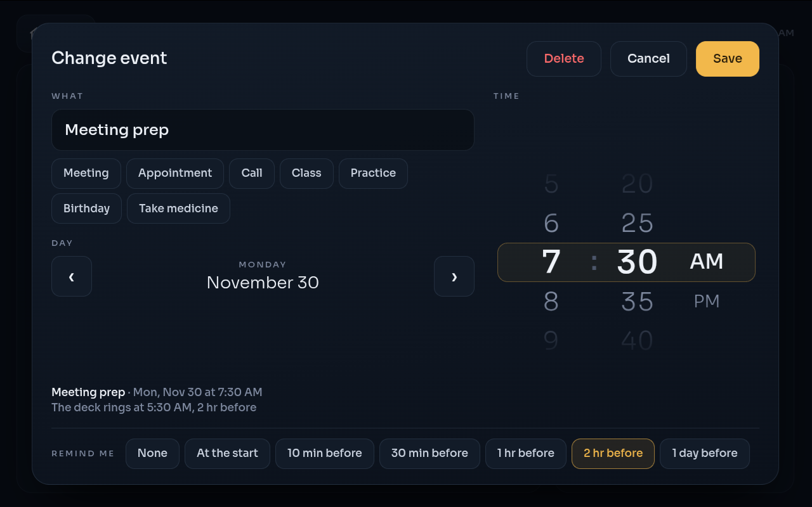
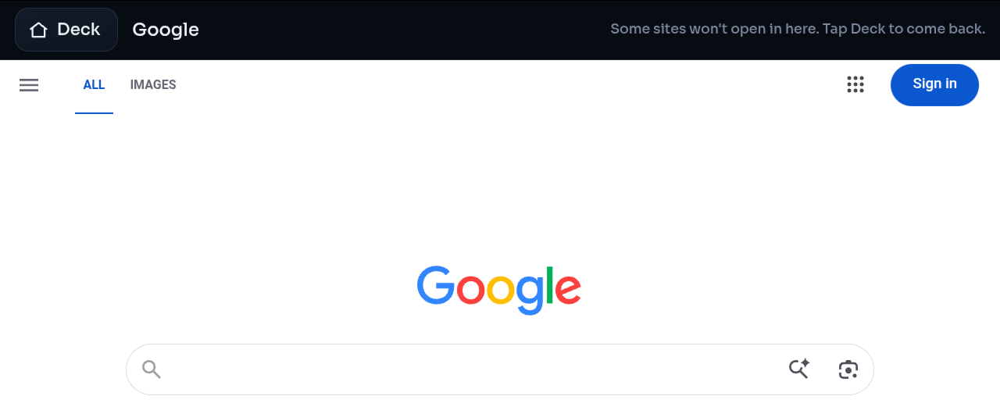
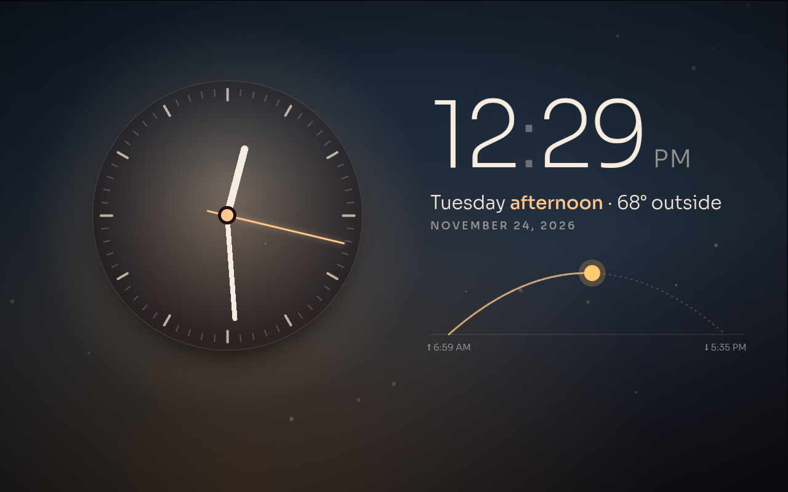

# Home Deck

Turn an Echo Show 8 (or any Android tablet) into a touch control desk for your home and your Windows PC.



- **Top left: apps on the screen itself.** Weather, a timer and alarm (flick-to-pick time wheels), a calendar where you can add events with reminders, and Google. These work even when your PC is off.
- **Top right: apps on your PC.** One tap opens Claude, ChatGPT, Terminal, Obsidian, or anything else you list. When one of them wants you (its taskbar button flashes, e.g. an answer is ready), its pad gets a small pulsing dot until you open it. Anything can also ping a pad with `POST /ping/<pad id>`.
- **Middle: Claude usage.** Your 5-hour and weekly Claude plan usage, and when each one resets. Tap it for the full picture: every limit (model-specific ones appear when your plan has them), a 7-day chart, where this week's usage went, and usage credits. This is optional.
- **Bottom: a clock, and what your PC is playing.** Tap the clock for **Hearth**, a cozy full-screen clock: light that follows the day, drifting embers, an analog clock, and the sun's (or moon's) path across today's sky. The cover picture, title and a progress line, with play/pause and 10-second skips. Tap the line to jump.
- **"Alexa, open sesame"** brings the deck back from the Alexa screen (Echo only, optional).

| Weather | Calendar | Timer & alarm |
|---|---|---|
|  |  |  |

| Adding an event with a reminder | Google | The Hearth clock |
|---|---|---|
|  |  |  |

## What you need

- **A Windows PC** with [Python 3.10+](https://www.python.org/downloads/). Nothing else needs installing.
- **A screen:**
  - **Any Android tablet** works: just install Fully Kiosk Browser and the deck runs.
  - **An Echo Show 8 (2nd gen)** has to be unlocked and rooted first. This is risky and could brick it. It isn't covered here: see the *saiyaku-athena* thread by R0rt1z2 on XDA Forums, and only do it if you're OK losing the device.
- **[Fully Kiosk Browser](https://www.fully-kiosk.com/)** on the screen. The free version is enough. Download it from its own site.
- **adb** ([Android platform-tools](https://developer.android.com/tools/releases/platform-tools)) on the PC, with the screen connected by USB.
- The screen and the PC on the same Wi-Fi.

## Setup

1. **Download this repo** to your PC.
2. **Copy `settings.example.json` to `settings.json`** and fill it in. Put it in `%USERPROFILE%\.homedeck\` (made on the helper's first run) or next to the code. The first is better if this folder is synced to OneDrive or similar, since it holds your calendar links.
   - `weather`: your town's name, a short label (like a ZIP code), its latitude and longitude, and `"us"` (°F, mph) or `"metric"` (°C, km/h). You can find the coordinates on Google Maps: right-click a spot to copy them.
   - `calendars`: Google Calendar *secret iCal addresses*, if you want them (see below). Up to 4 get their own colour.
   - `claude_usage`: `false` hides the Claude usage panel.
   - `now_playing`: `false` stops the PC helper reading what's playing.
   - `spotify_client_id`: optional, see *Spotify* below.
   - `adb`: the full path to `adb.exe`, if it isn't on your PATH.
3. **Choose your PC apps** in `pads.json`.
   - Each PC pad has an `id`, a logo (`icon`, from [Iconify](https://icon-sets.iconify.design/)), and `pc`: what to open.
   - `pc` can be a program's path, a link, or a Store app as `shell:AppsFolder\…`. To find a Store app's name, run `Get-StartApps` in PowerShell.
   - App IDs can differ between installs, so check the sample ones. For example, the ChatGPT app on my PC is listed as `OpenAI.Codex_…`.
   - `window` (optional) is the app's program name, as shown in Task Manager's **Details** tab (like `Obsidian.exe`). Windows doesn't let a background program put another app in front, so without it an app can open behind your other windows. With it, the helper brings the app's window to the front, un-minimizing it if needed.
   - `reuse` (optional, with `window`): `true` brings back the app's open window instead of opening another one. The sample Terminal pad uses it, since Terminal opens a new window each time.
4. **Start the PC helper:** `python deck_server.py`.
   - When Windows Firewall asks, allow Python on **private** networks.
   - To start it hidden at every login, make a shortcut in `shell:startup` to `pythonw.exe "C:\path\to\deck_server.py"`. Its output then goes to `%USERPROFILE%\.homedeck\deck.log`.
5. **Copy the deck to the screen:** plug it in by USB and run `python sync_echo.py`.
   - This copies the pages, makes Fully open the deck on start, and gives Fully permission to read them.
   - Setting Fully's start page needs root. On a normal tablet the script skips that step and tells you to set Fully's *Start URL* to `file:///sdcard/Android/data/de.ozerov.fully/files/home-deck/index.html` yourself, once.

Run `sync_echo.py` again whenever you edit a page, `pads.json` or `settings.json`, or when your PC's IP address changes.

### Your Google Calendar (no sign-in on the screen)

1. Open calendar.google.com, then Settings, then click your calendar under "Settings for my calendars".
2. Copy the **Secret address in iCal format** (it ends in `basic.ics`).
3. Paste it into `"calendars"` in `settings.json`, then run `sync_echo.py`.

Keep that address private: anyone who has it can read the calendar. If it leaks, press **Reset** next to it in Google Calendar.

### Adding your own events and reminders

Tap a day on the calendar, then **Add**.

- **Name it:** type a name with the screen's keyboard, or tap a ready-made one like Meeting or Call.
- **Pick the day and time:** use the arrows to change the day, and flick the wheels to set the time (in 5-minute steps). Tap **All day** for things like birthdays.
- **Choose when to be reminded:** at the start, or 10 min, 30 min, 1 hr, 2 hr or 1 day before. All-day events are reminded at 9 AM that morning or 9 AM the day before.
- **Change or delete it later:** tap the event in the list on the right.

When the reminder time comes, whichever deck page is open beeps and shows the event's name and time. Tap the screen to stop it. It beeps for up to 2 minutes, then waits quietly until you tap.

Some limits:

- **Saved on the screen only.** These events stay on the tablet and don't appear in Google Calendar.
- **Only rings on a deck page.** A reminder can't ring while Google or another app is open. If you come back to the deck within 10 minutes, it still rings.

### Claude usage (optional)

The helper reads the Claude sign-in that Claude Code saves on your PC (`~/.claude/.credentials.json`). Every 5 minutes it asks `api.anthropic.com` for your plan usage. It only saves the numbers, and the sign-in never leaves your PC except to go to Anthropic.

- This uses an **unofficial** endpoint, so it may stop working at any time.
- You need [Claude Code](https://claude.com/claude-code) installed and signed in on the PC.
- To turn it off, set `"claude_usage": false`.

### Now playing

The card at the bottom right shows what your PC is playing: anything that appears in the Windows volume pop-up, like YouTube in a browser, Spotify or Media Player.

- **The keys:** play/pause, and back or forward 10 seconds. You can also tap the progress line, or drag its knob, to jump there.
- **Full-screen player:** tap the cover. The cover grows into the left half of the screen, with the title, progress line and keys on the right, all over a blurred copy of the cover. Tap **Back** or the background to return.
- **Next and previous track** appear only when the app supports them. YouTube in a browser doesn't, unless you're playing a playlist. Spotify does, and pressing previous after the first few seconds restarts the song.
- **If several things play,** the card shows the one that's actually playing, not a paused video.
- **Some Spotify installs don't share what they play with Windows.** The card then reads the song from Spotify's window title instead, and looks up the album cover and song length with Deezer's or Apple's free music search. It only uses them when the song name matches exactly, so some songs show none. The position is the helper's own estimate (shown with a "~"), since it can't see jumps you make in Spotify.
- **How it works:** `nowplaying.ps1` reads Windows' media controls about once a second. The PC helper starts it, and it needs nothing installed.

### Spotify (optional)

Without this, a Spotify that doesn't share with Windows gets an estimated position and can't be dragged. Connecting Spotify's official Web API gives exact times, Spotify's own cover, and dragging through songs. Dragging needs Spotify Premium.

1. Go to the [Spotify developer dashboard](https://developer.spotify.com/dashboard), log in, and click **Create app**.
   - Any name and description.
   - **Redirect URI:** `http://127.0.0.1:8766/callback` (click **Add**).
   - Tick **Web API**, agree to the terms, and click **Save**.
2. In the app's **Settings**, copy the **Client ID** into `settings.json` as `"spotify_client_id"`. You don't need the client secret.
3. Run `python spotify_login.py`. Spotify's sign-in page opens in your browser: click **Agree**.
4. Restart the PC helper.

The sign-in only keeps a renewal token, in `%USERPROFILE%\.homedeck\.spotify-token`, on your PC only. If Spotify ever stops accepting it (it expires after months unused), the log says to run `spotify_login.py` again. To disconnect, delete that file, or remove the app at [spotify.com/account/apps](https://www.spotify.com/account/apps/).

### "Alexa, open sesame" (Echo only, optional)

On a rooted Echo Show, Alexa won't open apps. `echo-app/` is a tiny Android accessibility service that watches only Alexa's own screen. When your newest request reads "open sesame", it closes Alexa and brings Fully back to the front.

```sh
sh echo-app/build.sh            # needs Google's build-tools 36 + android-28 platform, a JDK and Python; see the top of build.sh
adb install -r echo-app/out/open-sesame.apk
# adds Open Sesame to the list, keeping any accessibility service you already use (like a screen reader)
adb shell 'cur=$(settings get secure enabled_accessibility_services); case "$cur" in null|"") new=com.homedeck.opensesame/.OpenSesame ;; *opensesame*) new=$cur ;; *) new="$cur:com.homedeck.opensesame/.OpenSesame" ;; esac; settings put secure enabled_accessibility_services "$new"; settings put secure accessibility_enabled 1'
```

On a tablet with an Accessibility menu, you can instead switch on **Open Sesame (home deck)** there.

To turn it off, run `adb uninstall com.homedeck.opensesame`.

## How it works

- **The pages run on the screen.** They live in Fully's own folder on the screen and load from `file://`, so they work with the PC off.
  - `sync_echo.py` writes `config.js` (your PC's address, the helper key, and your settings) and `pads.js` next to them.
  - Weather comes from [Open-Meteo](https://open-meteo.com/) (free, no key). The calendar reads iCal feeds directly, with its own repeat-event support.
- **`deck_server.py` is the PC helper.** It's plain Python with no installs, and listens on port 8765.
  - It only opens apps listed in `pads.json`, presses media keys, and reads and moves what's playing through Windows' media controls.
  - Every request has to carry a random key that it creates on first run, and it hides that key in its log.
- **Built for a 1280×800 screen.** Pages shrink themselves to fit smaller screens.

## Safety notes

- **Your private files live outside the code folder,** in `%USERPROFILE%\.homedeck\`: the deck key, the Spotify sign-in, Claude usage, the log and your `settings.json` if you put it there. So they're never uploaded with the code, and OneDrive or Dropbox don't copy them to the cloud if the code folder is synced. Never share them.
- Anyone on your Wi-Fi who learns the key could open the listed apps, see what's playing and control it, but nothing else.
- The screen talks to the PC over plain HTTP on your home network, so only use it on a Wi-Fi you trust, and allow the helper on **private** networks only.
- The key is also saved on the screen (in `config.js`, in Fully's folder).
- The pages load fonts from Google Fonts and logos from Iconify, so those services see your IP address when a page opens.
- For Spotify songs read from the window title, the PC helper sends the artist and song name to Deezer's and Apple's music search to find the cover.
- This project isn't made by or connected to Amazon, Anthropic, Google or Fully Kiosk. Logos are loaded from Iconify, and they belong to their owners.

## License

MIT. See [LICENSE](LICENSE).
